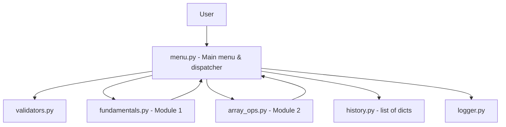
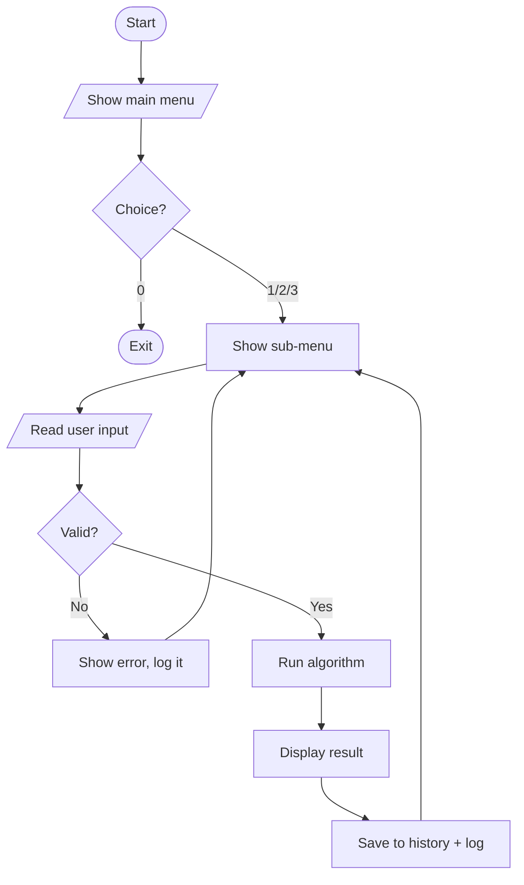
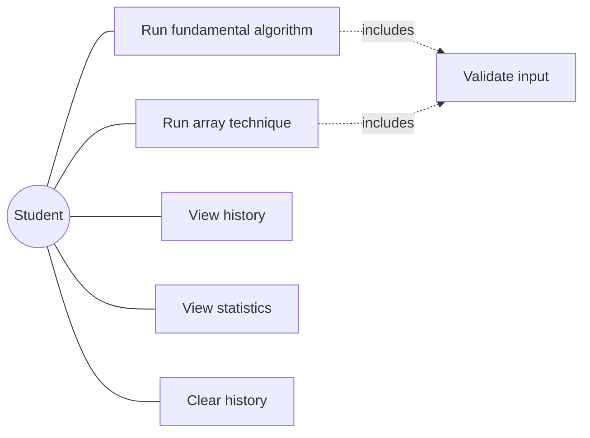
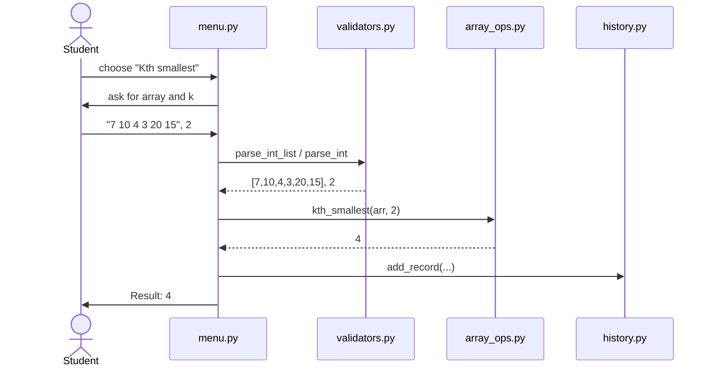
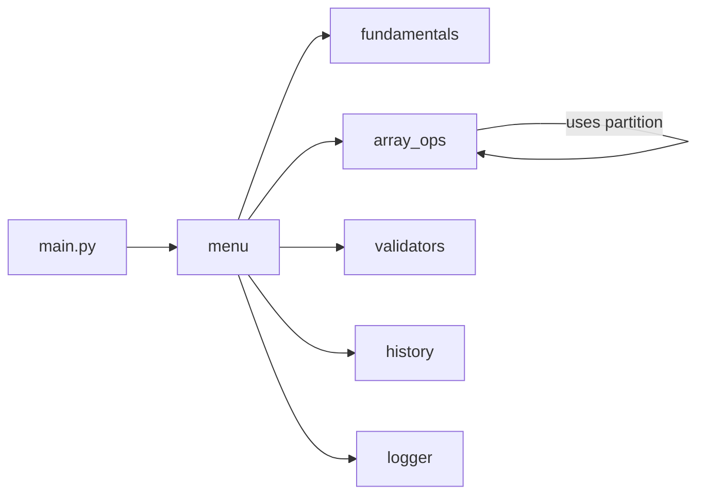

# Design Document — PySolve

## 1. Objectives
1. Implement the Unit 3 and Unit 5 algorithms from first principles.
2. Make every algorithm usable through a safe, validated interface.
3. Show compound data types (lists, dictionaries, tuples, sets) in real use.
4. Verify correctness with automated tests.

## 2. Functional Requirements
| ID | Requirement |
|---|---|
| FR1 | **Fundamental Algorithms module:** exchange, sum, digit operations, factorial, Fibonacci, reverse/palindrome, base conversion, and character/code-point conversion. |
| FR2 | **Array module:** reverse, count, max/min, remove duplicates, partition, Kth smallest. |
| FR3 | **CLI & history module:** menu navigation, result display, history list, usage statistics. |
| FR4 | Input: numbers or space/comma-separated lists typed at the prompt. Output: result printed and stored in history. |

## 3. Non-Functional Requirements
| Type | Requirement |
|---|---|
| Usability | Numbered menus, a Back option at every level, plain-language prompts. |
| Reliability / Error handling | Invalid input never crashes the program; a `ValueError` message is shown and the menu continues. |
| Maintainability | One module per concern, small functions, docstrings, no duplicated logic. |
| Performance | Core operations are linear or better where practical; insertion sort is O(n²), and quick-select is O(n) average / O(n²) worst case. Input limits keep displayed results responsive. |
| Logging / Monitoring | Every action and error is written to `pysolve.log`. |
| Testability | Pure functions separated from I/O; 21 unit tests. |
| Resource efficiency | Functions copy lists rather than mutating the caller's data; standard library only. |

## 4. System Architecture


## 5. Workflow Diagram


## 6. Use Case Diagram


## 7. Sequence Diagram (Kth smallest)


## 8. Component Diagram
The project uses functions instead of classes (as taught in the course), so a component
diagram is used.


## 9. Data / Storage Design
No database is used. History is kept in memory as a list of dictionaries:
```
{"id": 1, "category": "Arrays", "operation": "Kth smallest",
 "input": "...", "output": "4", "time": "15:19:09"}
```
Logs are appended to `pysolve.log` by Python's `logging` module.

## 10. Design Decisions & Rationale
- **Functions instead of classes:** matches the course scope and keeps the code easy to trace.
- **Pure algorithm functions, separate I/O layer:** algorithms can be tested without typing input.
- **Dictionary dispatcher for menus:** adding an operation only needs one new entry.
- **Two duplicate-removal methods:** demonstrates the time vs. memory trade-off from Unit 5.
- **Quick-select for Kth smallest:** reuses `partition` and is faster on average than sorting.

## 11. Testing Approach
Unit tests (`unittest`) cover: normal input, boundary values (0, empty list, single element),
invalid input (negative, non-numeric, wrong base), round-trip checks (decimal → base → decimal),
and a check that functions do not modify the caller's list. A scripted CLI run confirms the menus.
